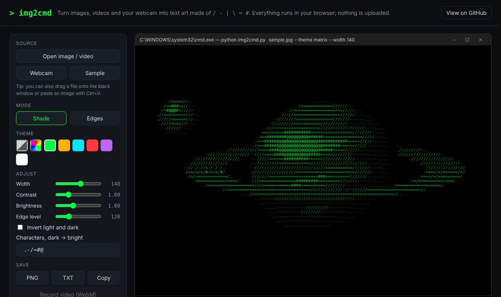
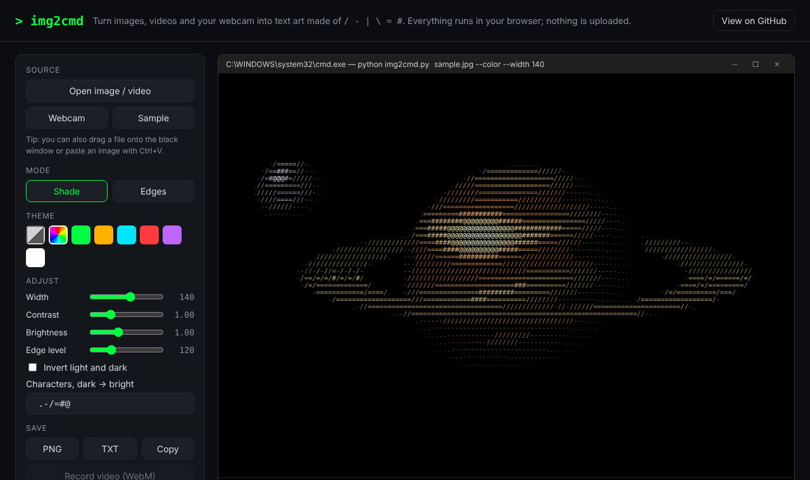
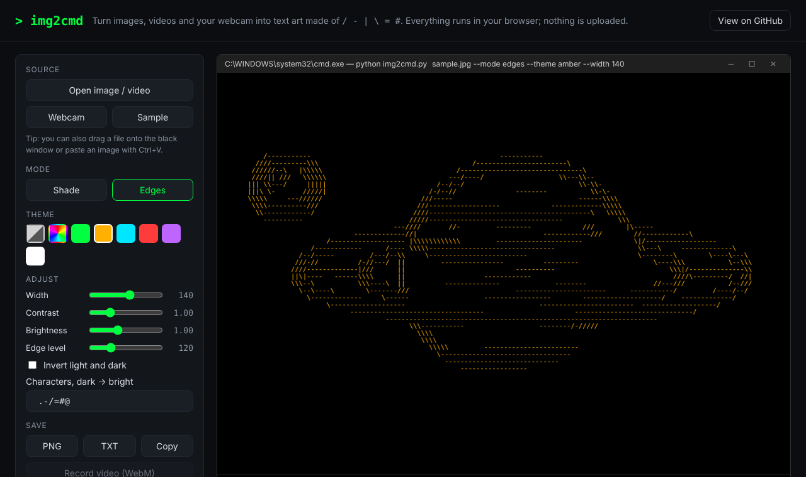

<div align="center">

# img2cmd

**Turn images, videos and your webcam into text art made of `/` `-` `|` `\` `=` `#`.**
Run it in Command Prompt with Python, or straight in your browser.

[](https://meshannawod.github.io/Image-to-CMD/)
[](#command-prompt-version)
[](LICENSE)



</div>

## Try it in your browser

**[meshannawod.github.io/Image-to-CMD](https://meshannawod.github.io/Image-to-CMD/)**

The web version uses the same rules as the Python script and runs entirely on your device, so nothing is uploaded.

- Open an image or video, drag one onto the window, or paste an image with Ctrl+V
- Use your **webcam** live (the browser asks for permission)
- Shade and edges modes, all six themes, original colors, invert, contrast, brightness and your own character set
- Save as **PNG** or **TXT**, copy the text, or **record a WebM video** of a video or webcam feed
- The title bar shows the matching `python img2cmd.py ...` command, so you can repeat the same look in Command Prompt

| Original colors | Edges + amber |
|---|---|
|  |  |

You can also open a look straight from a link, for example
[`?theme=amber&mode=edges&width=100`](https://meshannawod.github.io/Image-to-CMD/?theme=amber&mode=edges&width=100).

## Command Prompt version

### Requirements

- Python 3
- Pillow and OpenCV (OpenCV is needed for video and webcam)

```
pip install pillow opencv-python
```

### Setup

1. Put `img2cmd.py` in a folder, for example `C:\imgtool`.
2. Copy your photos or videos into the same folder.
3. Open Command Prompt there (in File Explorer, click the address bar, type `cmd`, press Enter).

### Quick start

```
python img2cmd.py photo.jpg
python img2cmd.py clip.mp4
python img2cmd.py --webcam
```

Or run `python img2cmd.py` and drag a file into the window when it asks.

### Themes

One-color looks. Brightness is kept, so the picture still has depth.

```
python img2cmd.py photo.jpg --theme matrix
python img2cmd.py clip.mp4 --theme amber --mode edges
```

Themes: `matrix` (green), `amber`, `cyan`, `red`, `purple`, `white`.
Use `--color` instead to keep the photo's original colors.

### Video

Plays in the window at its original speed. Press **Ctrl+C** to stop.

```
python img2cmd.py clip.mp4 --theme matrix --loop
python img2cmd.py clip.mp4 --seconds 10
```

- Supports `.mp4`, `.avi`, `.mov`, `.mkv`, `.webm`, `.wmv`, `.flv`. No sound.
- The picture fits your window height automatically.
- If it lags, use a smaller `--width`. Frames are skipped to stay in sync.

### Webcam

```
python img2cmd.py --webcam
python img2cmd.py --webcam 1 --theme cyan
```

- The number picks the camera (0 is the first, default). Use `--webcam` last or on its own.
- The picture is mirrored, like a real mirror. Press **Ctrl+C** to stop.
- Windows may ask for camera permission the first time.

### Save as picture or video

```
python img2cmd.py photo.jpg --out result.png
python img2cmd.py clip.mp4 --out result.mp4 --theme matrix
python img2cmd.py clip.mp4 --out result.gif --seconds 5
```

- Pictures: `.png` (or `.jpg`). Videos: `.mp4` or `.gif`.
- Saved videos have no sound.
- Saving a video takes a while, since every frame is drawn. Use `--seconds` for a quick test.
- GIFs get large fast, so keep them short.
- Default width when saving is 100 characters. Use `--width` for more detail.
- To save plain text instead, use `--save out.txt` (images only).

### Modes

**shade** (default) - brightness shown with characters from dark to bright.

**edges** - outlines using `-` `|` `/` `\` that follow the direction of each edge.

### All options

| Option | What it does |
|---|---|
| `--mode shade/edges` | Picture style (default shade) |
| `--theme NAME` | One-color look (matrix, amber, cyan, red, purple, white) |
| `--color` | Original photo colors |
| `--width 120` | Characters per line (default: window width) |
| `--invert` | Swap light and dark |
| `--contrast 1.5` | Stronger contrast (1.0 = normal) |
| `--brightness 1.2` | Brighter picture (1.0 = normal) |
| `--threshold 80` | Edge sensitivity (lower = more lines, default 120) |
| `--ramp " -/#"` | Your own characters, dark to bright |
| `--out FILE` | Save as picture (.png) or video (.mp4 / .gif) |
| `--save FILE.txt` | Save an image's plain text |
| `--fps 15` | Video/webcam speed |
| `--seconds 10` | Video: only the first N seconds |
| `--loop` | Video: repeat until Ctrl+C |
| `--webcam [N]` | Live camera |

### Tips

- Maximize the window for a bigger, clearer picture. Colors need Windows 10+ or Windows Terminal.
- If lines wrap and look broken, use a smaller `--width`.
- Edges mode works best on photos with clear shapes and good contrast.
- Names with spaces need quotes. A folder path converts every image and video inside it.

## Project files

| File | What it is |
|---|---|
| `img2cmd.py` | The Command Prompt tool (Python) |
| `index.html` | The browser version (no install, no build step) |
| `assets/sample.jpg` | Sample picture used by the web demo |
| `docs/` | Screenshots for this page |
